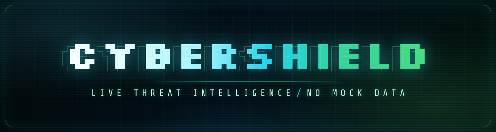
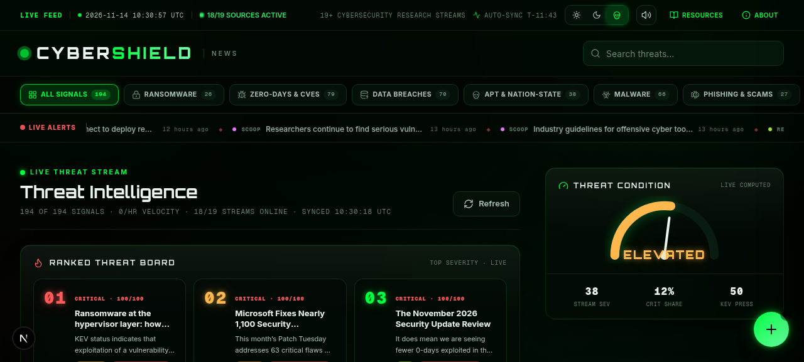
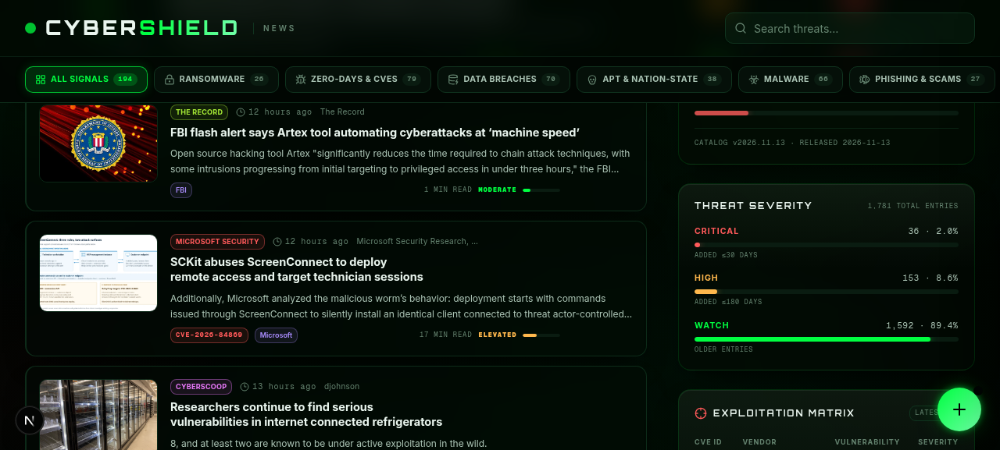
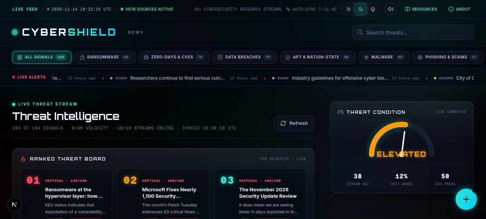
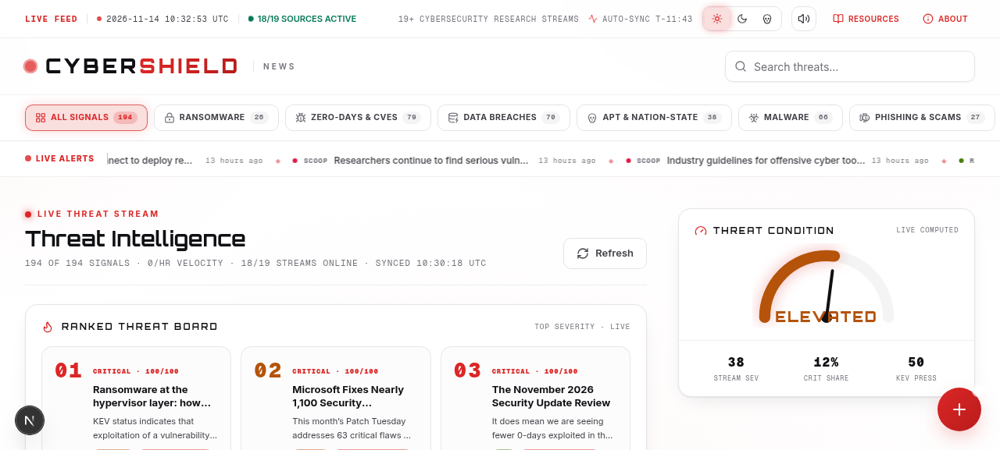
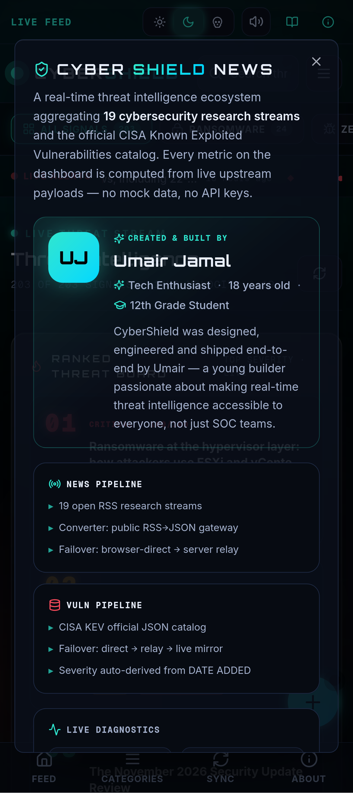
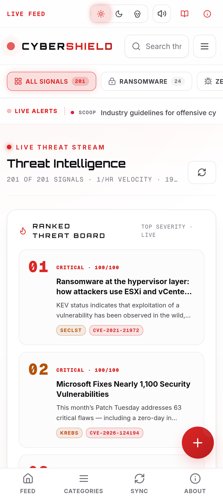

<div align="center">



**LIVE THREAT INTELLIGENCE — a real-time SOC dashboard that fuses 20+ cybersecurity
research streams with the official CISA Known Exploited Vulnerabilities catalog,
rendered as a glassmorphic mission-control HUD with three complete skins.**

[](https://nextjs.org/)
[](https://react.dev/)
[](https://www.typescriptlang.org/)
[](https://tailwindcss.com/)

[](https://cybershield-news.vercel.app/)
[](https://github.com/myself-umair/CyberShield/stargazers)
[](#-three-complete-skins)
[](#-security-posture)

</div>

<details>
<summary><b>▣ The raw terminal banner — pure ASCII (click to expand)</b></summary>

```
 ██████╗  ██╗   ██╗ ██████╗   ███████╗  ██████╗   ███████╗  ██╗  ██╗  ██╗ ███████╗  ██╗       ██████╗   
██╔════╝  ╚██╗ ██╔╝ ██╔══██╗  ██╔════╝  ██╔══██╗  ██╔════╝  ██║  ██║  ██║ ██╔════╝  ██║       ██╔══██╗  
██║        ╚████╔╝  ██████╔╝  █████╗    ██████╔╝  ███████╗  ███████║  ██║ █████╗    ██║       ██║  ██║  
██║         ╚██╔╝   ██╔══██╗  ██╔══╝    ██╔══██╗  ╚════██╗  ██╔══██║  ██║ ██╔══╝    ██║       ██║  ██║  
╚██████╗     ██║    ██████╔╝  ███████╗  ██║  ██║  ███████║  ██║  ██║  ██║ ███████╗  ███████╗  ██████╔╝  
 ╚═════╝     ╚═╝    ╚═════╝   ╚══════╝  ╚═╝  ╚═╝  ╚══════╝  ╚═╝  ╚═╝  ╚═╝ ╚══════╝  ╚══════╝  ╚═════╝   

                               LIVE THREAT INTELLIGENCE

                               NO MOCK DATA — MAP THE THREATS
```

</details>

---

## 📸 Screenshots

<div align="center">
<table>
  <tr>
    <td align="center"><b>🟢 Hacker Matrix — command deck with live threat condition</b></td>
    <td align="center"><b>🟢 Matrix Feed — ranked board, severity analytics, KEV bars</b></td>
  </tr>
  <tr>
    <td></td>
    <td></td>
  </tr>
  <tr>
    <td align="center"><b>🔷 Navy Dark — the default mission-control skin</b></td>
    <td align="center"><b>🔴 Light Ops — clean daylight briefing deck</b></td>
  </tr>
  <tr>
    <td></td>
    <td></td>
  </tr>
  <tr>
    <td align="center"><b>🧑‍💻 Created & Built by: Umair jamal</b></td>
    <td align="center"><b>📱 Mobile 390px — fully responsive, zero horizontal scroll</b></td>
  </tr>
  <tr>
    <td></td>
    <td></td>
  </tr>
</table>
</div>

---

## 🛡️ What is CYBERSHIELD?

CYBERSHIELD is a **real-time cyber threat intelligence dashboard** that turns the firehose
of the security internet into one disciplined, live mission-control view. Open the app and it:

1. **Aggregates 20+ cybersecurity research streams** — BleepingComputer, The Hacker News,
   Krebs on Security, SecurityWeek, Threatpost, The Record, CISA alerts and more — into a
   single ranked signal stream with dedupe, severity scoring and category tagging, and
2. **Fuses the official CISA Known Exploited Vulnerabilities (KEV) catalog** into live
   widgets — threat condition, exploitation matrix, KEV pressure — computed from real
   catalog entries, not sample data, and
3. **Presents it all as a glassmorphic mission-control HUD** — a JARVIS-style boot sequence,
   animated threat-condition gauge, matrix-rain article thumbnails, a three-skin theme engine
   (Light / Navy Dark / Hacker Matrix) and a fully responsive mobile deck.

**There is no mock data anywhere.** If a widget shows a number, it was computed from a live
feed or the official KEV catalog. Everything runs through the app's own API routes with
server-side aggregation and caching, so the browser never scrapes and the UI never blocks.

---

## ✨ Features

### 📡 Live Intelligence
- **20+ research streams, one signal** — server-side RSS/Atom/JSON aggregation with normalised
  titles, source attribution, relative timestamps and per-article severity (CRITICAL / HIGH /
  ELEVATED / MODERATE / WATCH) derived from content heuristics and KEV cross-matching.
- **CISA KEV fusion** — the official Known Exploited Vulnerabilities catalog powers the
  exploitation matrix (CVE ID, vendor, vulnerability, severity), the KEV pressure stat on the
  threat-condition gauge and the version/release ticker.
- **Ranked threat board** — the day's most severe stories ranked 01/02/03… with top severity,
  0-day velocity and stream health in the header meta strip.
- **Category intelligence** — All Signals, Ransomware, Zero-Days & CVEs, Data Breaches,
  APT & Nation-State, Malware, Phishing & Scams, AI Security — each with a live signal count.
- **Source manager** — check/uncheck any source to reshape the stream; the topic
  cloud (Malware, Exploit, Patch…) recomputes from the live corpus.
- **Deterministic pagination** — exactly 20 cards cold, explicit **LOAD MORE** adds 20 more
  (20 → 40 → 60…). No runaway infinite scroll.

### 🎛️ Mission Control HUD
- **Threat condition gauge** — a live-computed ELEVATED/DEFCON-style arc combining top stream
  severity, critical share and KEV pressure.
- **Threat severity analytics** — CRITICAL / HIGH / WATCH distribution bars over the full
  catalog, with age windows (≥30 days, ≥100 days) counted from real KEV dates.
- **Exploitation matrix** — the latest KEV additions as a live table with severity chips.
- **Live alerts ticker** — a scrolling wire of breaking items with per-source color coding.
- **Search** — instant client-side filtering across the entire loaded corpus.
- **Auto-sync clock** — UTC mission clock and last-sync heartbeat in the top bar.

### 🎨 Experience
- **Three complete skins** — LIGHT (white + crimson ops), DARK (the navy/aqua glass HUD) and
  HACKER (Hexwall matrix-green on translucent black). One three-segment switch — Sun, Moon,
  Skull — with persistence across reloads.
- **JARVIS boot sequence** — animated radar sweep, lock flash and a welcome voice that
  pre-unlocks the audio channel on your first interaction (browser policy-safe).
- **Matrix-rain thumbnails** — article cards get generative canvas thumbnails in hacker green,
  navy rain or clean light style, per theme.
- **Exact-anchor navigation** — Resources and Threat Feed land pixel-exact (128px / 144px)
  thanks to a settle-and-correct scroll observer.
- **Sound design** — optional UI ambience with a top-bar sound toggle.
- **Fully responsive** — 390px mobile deck with bottom navigation and zero horizontal scroll.

### 🧱 Engineering
- **Next.js 16 App Router** with typed API routes (`/api/news`, `/api/cisa`) doing server-side
  aggregation, normalisation and caching — the browser only ever talks to your own backend.
- **TypeScript strict, Tailwind CSS 4, shadcn/ui components, Lucide icons, Framer Motion
  transitions, Three.js boot scene.**
- **Vercel-ready** — `output: standalone`, zero external services, no database required.

---

## 🚀 Quick Start

```bash
# 1 — clone
git clone https://github.com/myself-umair/CyberShield.git
cd CyberShield

# 2 — install (pick your package manager)
bun install        # bun (recommended)
npm install        # npm
pnpm install       # pnpm

# 3 — run
bun run dev        # → http://localhost:3000
```

> **First boot plays a JARVIS-style welcome voice and radar sweep.** Browsers block autoplay
> audio until your first click/scroll/keypress — interact once and the voice engages cleanly.

### 📜 Scripts

| Script | What it does |
| --- | --- |
| `bun run dev` | Dev server on port 3000 (Turbopack) |
| `bun run build` | Production build (standalone output) |
| `bun run start` | Serve the production build |
| `bun run lint` | ESLint (Next core-web-vitals + TypeScript) |

---

## 🎨 Three Complete Skins

One switch in the top bar cycles the whole application — tokens, aurora, glass tints,
thumbnails, gauges, boot sequence — between three hand-tuned skins:

| Skin | Look | Signature |
| --- | --- | --- |
| ☀️ **LIGHT** | Clean white + crimson ops | Daylight briefing deck, red severity accents |
| 🌙 **DARK** | Pitch-black navy glass | Aqua/teal brand pair, navy aurora blooms — the default |
| 💀 **HACKER** | Hexwall matrix green | `#00FF41` signal green on translucent black, skull segment lit |

The choice persists across reloads (`cs-theme`), and every severity color, glow and canvas
thumbnail re-derives from the active skin's token set.

---

## 🔒 Security Posture

- Ships **Next.js 16.4.6 (exact)** — outside the vulnerable range (≥16.0.0 ≤16.4.0) of
  GHSA-2464-fhr4-w9xw (critical, Image Optimization RCE), GHSA-673q-mjm6-r5xr (critical,
  `use cache` RCE) and GHSA-p3m5-59mp-jv5r (high, Server Actions DoS).
- All feed ingestion happens **server-side** in API routes with caching; the client never
  fetches third-party origins directly.
- Hydration hardened against browser-extension DOM stamping (`suppressHydrationWarning` on
  extension-touched media/body nodes).

---

## 🛰️ Data Sources & Attribution

All content is aggregated from publicly available feeds and the official
[CISA Known Exploited Vulnerabilities Catalog](https://www.cisa.gov/known-exploited-vulnerabilities-catalog)
and remains the property of its respective publishers. CYBERSHIELD is an intelligence *reader*
— it links every story back to its original source.

---

## 🔥 Live Demo

**CyberShield News** is live and tracking 19+ cybersecurity research streams in real time! 🛡️

👉 **[Launch CyberShield Live](https://cybershield-news.vercel.app/)**

* 🔥 **Real-Time Threat Feed:** Aggregating ransomware, zero-days, CVEs, and APT advisories.
* 🔥 **Live CISA KEV Sync:** Instant tracking of known exploited vulnerabilities.
* 🔥 **Built-in Resources:** Explore the full documentation, product deck, and explainer film directly on the site.
---
<div align="center">

**CYBERSHIELD — MAP THE THREATS**

*Built with Next.js 16 · React 19 · Tailwind 4 · no mock data, ever.*
</div>

---
